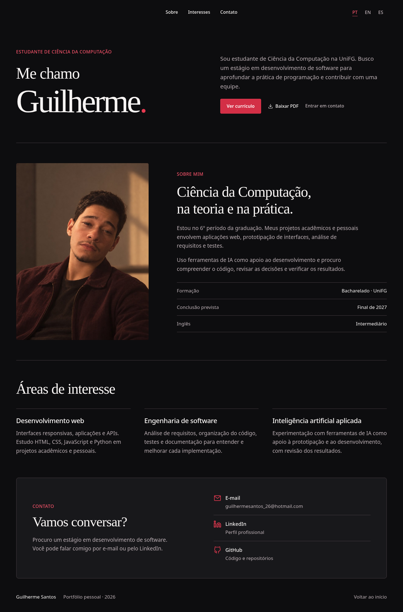

# Portfólio | Guilherme Santos

Portfólio profissional público de Guilherme dos Santos, estudante de Ciência da Computação. Apresenta formação acadêmica, áreas de interesse, currículo e formas de contato.

**Site:** [gdsantos-dev.com](https://gdsantos-dev.com/)



## O que está disponível

- Páginas em português brasileiro, inglês e espanhol.
- Apresentação, formação, áreas de interesse, projetos e contato.
- Página inicial compacta de ScoutLIQ e DashLIQ: nome, resumo e link para o estudo de caso, em PT/EN/ES.
- Estudos de caso em páginas próprias, com contexto, processo, escolhas de engenharia e limites de validação.
- Currículo em PDF para consulta e download.
- Layout responsivo e metadados de compartilhamento.

## Tecnologias

HTML, CSS e JavaScript, servidos por Node.js sem dependências externas. Dockerfile para deploy no Railway.

## Executar localmente

Requer Node.js 20 ou superior.

```bash
npm start
```

Acesse `http://localhost:3000/pt/` (ou `/en/` e `/es/`).

## Estrutura

- `public/`: versão estática publicada (HTML, CSS, JS, imagens, PDF e conteúdo).
- `server.mjs`: servidor HTTP para os arquivos públicos.
- `Dockerfile`: configuração de execução em contêiner.
- `docs/`: capturas de tela para a documentação do repositório.

## Desenvolvimento e publicação

Este repositório contém **somente a versão pública** do portfólio. O laboratório de desenvolvimento, seus arquivos de configuração e o banco local não fazem parte deste repositório.

Atualmente, o deploy do site é realizado manualmente no Railway. Alterar o código aqui **não atualiza automaticamente** o site publicado. Para publicar alterações, é necessário fazer novo deploy.

O arquivo `public/data/projects.json` mantém o conteúdo dos projetos próprios exibidos na seção editorial. A apresentação minimalista é gerada por `public/projects-cinema.js` e estilizada por `public/projects-cinema.css`. A página principal não exibe capturas, galerias ou painéis provisórios. As imagens pertencem à experiência aprofundada de **Conhecer o projeto**, cuja revisão visual fica para a etapa seguinte. As capturas de teste do ScoutLIQ permanecem no histórico e no repositório do próprio sistema, mas não devem ser mostradas no portfólio sem aprovação. Para incluir imagens, acrescente `images` a cada item do JSON e publique os arquivos correspondentes em `/public/assets/projects/<id>/`. Links para repositórios privados e demonstrações não publicadas ficam de fora da vitrine.

As páginas de case são `/{pt|en|es}/projeto/?id=scoutliq` e `/{pt|en|es}/projeto/?id=dashliq`; o conteúdo fica em `public/data/projects.json` (chave `texts.<idioma>.case`) e é construído por `public/project-case.js`. As páginas internas incluem navegação por capítulos com âncoras, leitura sem bloqueio do scroll e uma explicação da colaboração humano–IA. Não divulgamos nomes de modelos ou ferramentas específicas. O script de verificação é `node scripts/validate-project-showcase.mjs`, também executado no GitHub Actions.

As páginas do site não usam navegação que bloqueie o scroll. As transições são discretas, e `prefers-reduced-motion` é respeitado. A validação visual em desktop e celular deve acontecer antes de integrar esta alteração à branch principal.

> O currículo em `public/data/curriculos/` é parte do site público e também fica acessível neste repositório.

## Cache do navegador após atualizações

Os arquivos CSS e JavaScript públicos são revalidados pelo servidor para evitar que uma versão antiga de estilos seja combinada com o HTML/JS novo. As páginas referenciam os estilos e scripts da vitrine com uma versão de publicação no URL.

Se o layout após deploy mostrar imagens empilhadas ou fontes sem o estilo esperado, confirme a pasta publicada e recarregue forçando atualização do navegador (`Ctrl + Shift + R` no Chrome desktop). Não altere apenas o HTML sem atualizar os arquivos CSS/JS correspondentes.

## Estudos de caso

Os dois estudos de caso usam o mesmo tema Black & Crimson e a hierarquia editorial do portfólio. As linhas decorativas repetidas foram substituídas por espaçamento; só permanecem separações pontuais de hierarquia. O link final exibe “Próximo projeto”, e a seção de validação distingue resultados locais relatados de verificações independentes. A atualização é limitada às páginas de projeto; não modifica os sistemas apresentados.

## Refinamento de linguagem e alinhamento

No estudo de caso do DashLIQ, os textos foram revistos nos três idiomas para explicar organização de receitas, despesas, compromissos e metas pessoais, sem associações com apostas. Os rótulos dos capítulos ficam acima de seus títulos, ambos alinhados à margem esquerda, preservando o visual editorial do portfólio também no mobile. O destaque do capítulo ativo agora acompanha a posição real da leitura e restaura âncoras abertas diretamente por URL.

## Disponibilidade pública do ScoutLIQ

O repositório do ScoutLIQ está público em https://github.com/gdsantos-dev/ScoutLIQ. O estudo de caso inclui o link “Ver código no GitHub” na seção de disponibilidade, com traduções em inglês e espanhol. A publicação do código **não implica** que existam uma demonstração interativa ou capturas da interface aprovadas para divulgação.

## Currículo multilíngue

A versão portuguesa é a referência do currículo. O script `scripts/gerar_curriculos_traduzidos.py` gera versões em inglês e espanhol a partir do Word original, preservando os dados, identidade Black & Crimson e links. O workflow `atualizar-cores-curriculo.yml` gera PDF e DOCX para PT/EN/ES e valida os documentos. Os botões “Ver currículo” e “Baixar PDF” exibem/baixam o idioma correspondente à página acessada.

## Metadados e sitemap dos projetos

As páginas iniciais mantêm metadados traduzidos em PT, EN e ES. Para links `/{pt|en|es}/projeto/?id=scoutliq` e `?id=dashliq`, o servidor entrega o título, descrição, tags Open Graph/Twitter, URL canônica e idiomas alternativos específicos diretamente no HTML inicial, antes de executar o JavaScript. Não são criadas imagens fictícias de prévia. O sitemap (`public/sitemap.xml`) inclui as três páginas principais e os seis estudos de caso, com relações `hreflang`. Verifique com `node scripts/validate-project-seo.mjs` (integrado ao CI); publicar exige deploy manual.

## Dependências da imagem de produção

O `server.mjs` importa `scripts/project-seo.mjs` para gerar metadados públicos dos estudos de caso. Por isso, ambos precisam ser copiados no Dockerfile. O GitHub Actions constrói a imagem e testa `/health`, URLs dos casos e `sitemap.xml` antes de aprovar atualizações. A configuração do deploy permanece manual e não inclui o restante dos scripts de desenvolvimento.

## Navegação por rolagem na página inicial

A URL acompanha a seção realmente visível durante a rolagem, nos três idiomas, utilizando `history.replaceState` para não gerar entradas extras no histórico. Ao voltar ao topo, o fragmento é removido. Clicar em âncoras, recarregar links diretos e o sistema de capítulos das páginas de projetos continuam funcionando. Código em `public/section-tracker.js`, validado por `node scripts/validate-section-tracker.mjs`.
